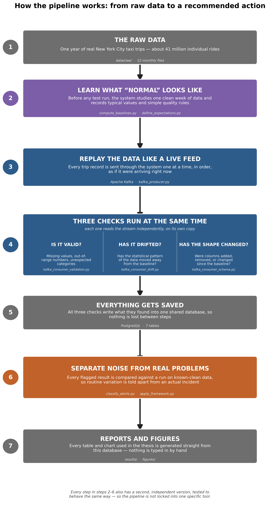

# End-to-End Data Quality Monitoring Pipeline for Streaming Data

Bachelor's thesis artifact, B.Sc. Data Science, IU International University of Applied Sciences.
Author: Dost Muhammad. Supervisor: Dr. Mark Menzel.

The pipeline monitors a replayed stream of NYC TLC Yellow Taxi Trip Records (2024,
41,169,720 records) for data quality defects, distributional drift and schema change.
It integrates Apache Kafka, Great Expectations, PostgreSQL, MLflow and Apache Airflow
behind five adapter interfaces and runs with Docker Compose on a single node. On top
of the raw alerts it adds an alert classification rule and an Alert Interpretation
Framework that recommends an action for every alert.

This README explains how to set the pipeline up, reproduce the eight experiment runs
and rebuild every result table and figure from the database.

## Contents

- [Architecture](#architecture)
- [Experimental design](#experimental-design)
- [Requirements](#requirements)
- [Setup](#setup)
- [Configuration](#configuration)
- [Running the experiments](#running-the-experiments)
- [Analysis](#analysis)
- [Diagnostics](#diagnostics)
- [Tests](#tests)
- [Airflow DAGs](#airflow-dags)
- [Outputs](#outputs)
- [Web interfaces](#web-interfaces)
- [Project layout](#project-layout)
- [Data source](#data-source)
- [Citation](#citation)

## Architecture



A run is a full replay of the corpus, not a live deployment. Each experiment deletes
and recreates the Kafka topic with a single partition, republishes all 41,169,720
records in event-time order, and then runs three consumers over the replayed stream:

| Consumer | Script | Writes to |
|---|---|---|
| Validation | `scripts/kafka_consumer_validation.py` | `validation_runs`, `expectation_failures`, `quarantined_rows` |
| Drift | `scripts/kafka_consumer_drift.py` | `drift_scores`, MLflow |
| Schema | `scripts/kafka_consumer_schema.py` | `schema_snapshots` |

Production and consumption are sequential. All results are written to the PostgreSQL
schema `dq_monitoring` (seven tables, created by
`docker/postgres-init/02-monitoring-schema.sql`), and every row carries the identifier
of the experiment that produced it.

`docker-compose.yml` defines seven services: PostgreSQL, Zookeeper, Kafka, MLflow and
three Airflow containers. Six are long-running; `airflow-init` exits once the Airflow
metadata database is migrated.

Five points allow a component to be substituted without changing the meaning of an
experiment. Each has a second implementation and an equivalence test in
`tests/test_adapter_equivalence.py` or `tests/test_fallback_equivalence.py`:

| Interface   | Primary                            | Fallback              |
|-------------|------------------------------------|-----------------------|
| EventSource | Apache Kafka (single partition)    | `ParquetEventSource`  |
| Validator   | Great Expectations 1.1.3           | `PlainValidator`      |
| MetricStore | PostgreSQL, schema `dq_monitoring` | `CsvMetricStore`      |
| RunTracker  | MLflow                             | `JsonRunTracker`      |
| Scheduler   | Apache Airflow                     | `SequentialScheduler` |

The five boundaries are declared as structural `Protocol`s in `scripts/interfaces.py`,
so the primary components conform without modification. The fallbacks live in
`scripts/fallbacks.py` and `scripts/plain_validator.py`.

## Experimental design

The reference distribution is the first week of January 2024 (609,698 records).
Records are grouped by pickup time into windows of 10,000 records, which gives 4,117
windows per run. Eleven of the 19 columns are monitored: five numerical features with
PSI and the Kolmogorov-Smirnov test, and six categorical features with PSI and the
chi-square test, which makes 22 feature and metric pairs and 90,574 drift scores per run.

A window raises an alert only when all three conditions hold
(`scripts/kafka_consumer_drift.py`):

- PSI above 0.20, or a p-value below 0.05 for the Kolmogorov-Smirnov or chi-square test
- at least 500 records in the window
- an effect size of at least 0.1 (the D statistic, or the categorical magnitude)

Every injected change starts at the same activation point, row 20,584,860
(3 July 2024, 23:35:25), so the ground truth is exact. The injections are defined in
`scripts/drift_injection.py`:

| Run | Change from the activation point | Target |
|-----|----------------------------------|--------|
| C0  | clean control, nothing injected | none |
| S1  | mean shift of +0.75 standard deviations | `fare_amount` |
| S2  | payment types 1 and 2 swapped | `payment_type` |
| S3  | rare rate code 99 raised to 25% | `RatecodeID` |
| S4  | spread doubled on a log scale, median kept | `trip_distance` |
| S5  | S1 at +0.5 standard deviations combined with S2 | `fare_amount`, `payment_type` |
| S6  | unseen rate code 88 injected at 25% | `RatecodeID` |
| S7  | new column added, no value changed | schema |

## Requirements

- WSL2 Ubuntu or native Linux. Do not run from a Windows drive mount (`/mnt/*`):
  the Docker volumes hold the database, and that file system path is about ten
  times slower.
- Python 3.11
- Docker and Docker Compose
- About 1 GB of free disk for the raw Parquet corpus (661 MB), plus room for the
  PostgreSQL volume and the Python environment

Dependencies are pinned in `requirements.txt` (14 direct packages) and
`requirements-lock.txt` (the full transitive set).

## Setup

```bash
git clone https://github.com/Dost-DS/data-quality-pipeline.git
cd data-quality-pipeline
python3.11 -m venv .venv && source .venv/bin/activate
pip install -r requirements-lock.txt

docker compose up -d
sleep 25   # let Postgres, Kafka and MLflow finish initializing

python scripts/download_dataset.py     # 12 monthly Parquet files into data/raw/
python scripts/init_gx_context.py      # Great Expectations file-backed context
python scripts/compute_baselines.py    # reference_baseline.json, schema_baseline.json
python scripts/define_expectations.py  # expectation suite and feature dependency map
```

The repository already contains the baselines and the expectation suite used in the
thesis, so the last two commands are only needed to rebuild them.

## Configuration

The scripts read their connection settings from environment variables and fall back to
the values of the local Docker Compose stack:

| Variable | Default | Used for |
|---|---|---|
| `PG_HOST` | `localhost` | PostgreSQL host (port 5432) |
| `KAFKA_BOOTSTRAP_SERVERS` | `localhost:29092` | Kafka broker |
| `KAFKA_TOPIC` | `taxi-trips` | topic the replay publishes to |
| `MLFLOW_TRACKING_URI` | `http://localhost:5000` | MLflow server |
| `USE_MLFLOW` | `1` | set to `0` to run the drift consumer without MLflow |

The credentials in `docker-compose.yml` and in the scripts are for this local stack only.

## Running the experiments

### 1. Window-size pilot

```bash
python scripts/pilot_window_size.py   # 200,000 clean records at five window sizes
```

The pilot replays the same clean slice at window sizes of 1,000, 2,500, 5,000, 10,000
and 25,000 records and stores each as a `PILOT` experiment.

### 2. The eight replays

Each replay takes about three hours (produce about 104 min, validate about 30 min,
drift about 37 min, schema about 12 min), so start it in `tmux`:

```bash
tmux new-session -d -s c0 "cd ~/thesis/data-quality-pipeline && source .venv/bin/activate && \
python scripts/run_experiment.py --scenario C0 --warmup-rows 20584860 --window-size 10000 \
--timeout-seconds 180 --report-every 2000000 2>&1 | tee logs/logs_C0.txt"
```

Repeat with `S1` to `S7`, changing the session name and the log file each time.

- Run `C0` first. Classification needs the control run.
- Do not truncate `dq_monitoring` between scenarios, because classification needs every
  earlier run to still be present.
- Never start the same scenario twice at the same time. Two runs writing to the same log
  file through `tee` overwrite each other's output.

Between replays, confirm that the run reached the database:

```bash
python scripts/verify_experiment.py <experiment_id>
```

It checks `experiments`, `validation_runs`, `drift_scores` and `schema_snapshots` and
prints the recorded activation point. The experiment identifier is printed at the start
of each run, and `logs/run_register.txt` lists the identifiers of the runs reported in
the thesis.

## Analysis

Run these after all eight replays, in this order. Each step reads what the previous one
wrote to `alert_classifications`.

```bash
python scripts/classify_alerts.py      # labels every alert; rebuilds all runs together
python scripts/apply_framework.py      # recommended action per alert
python scripts/build_result_tables.py  # result CSVs in results/
python scripts/generate_figures.py     # figures in figures/
python scripts/blind_mode_eval.py      # framework without ground truth
python scripts/blind_mode_v2.py        # control distribution, percentile sweep
```

Integrity check after any restart of the stack:

```bash
docker exec -i pipeline-postgres psql -U pipeline_admin -d postgres -c \
  "SELECT COUNT(*) FROM dq_monitoring.alert_classifications;"
```

## Diagnostics

These scripts only read from the database and the raw files, and write CSVs to `results/`:

| Script | What it checks |
|---|---|
| `scripts/diag_unsourced.py` | persistence rule, per-feature 99th percentile calibration, RatecodeID pre-activation means |
| `scripts/diag_psi_bins_blind_c7.py` | empty reference bins under PSI, and blind-mode behavior of criterion C7 (options `--skip-psi`, `--skip-blind`, `--scenarios`) |
| `scripts/chi2_floor_sensitivity.py` | how much of the chi-square value comes from the expected-count floor (prints only) |

`diag_psi_bins_blind_c7.py` rebuilds windows from `data/raw/`, so the corpus must be
downloaded first.

## Tests

```bash
pytest tests/ -q -m "not integration"   # offline tests
pytest tests/ -q                        # all tests, including the Kafka comparison
```

The test marked `integration` needs a running broker and a populated topic. Tests that
read real corpus windows are skipped when `data/raw/` is empty.

| File | Covers |
|---|---|
| `test_drift_metrics.py` | PSI, Kolmogorov-Smirnov and chi-square, and the PSI bin geometry |
| `test_alert_classifier.py` | the classification rule and its precedence |
| `test_interpretation_framework.py` | the recommended action for each kind of alert |
| `test_adapter_equivalence.py` | Great Expectations and `PlainValidator` agree on all 32 expectations |
| `test_fallback_equivalence.py` | the other four fallbacks against their primaries |

## Airflow DAGs

| DAG | Schedule | What it does |
|---|---|---|
| `dq_stack_health` | hourly | checks that every service is reachable and that `dq_monitoring` has the expected tables |
| `dq_drift_summary` | daily | summarizes alert rates per experiment against the control and writes `results/dag_*.csv` |

Neither DAG changes the database. The experiments themselves are started by hand, as described above.

## Outputs

| Folder | Content | Written by |
|---|---|---|
| `results/` | `alert_classification`, `c0_control_alerts`, `drift_by_scenario`, `framework_actions`, `framework_detail`, `latency_by_scenario`, `pilot_window_size`, `recall_by_metric` | `build_result_tables.py` |
| `results/` | `blind_mode_detail`, `blind_mode_crosstab` | `blind_mode_eval.py` |
| `results/` | `blind_mode_v2` | `blind_mode_v2.py` |
| `results/` | `diag_*.csv` | the diagnostic scripts |
| `results/` | `dag_*.csv` | the `dq_drift_summary` DAG |
| `figures/` | eleven figures | `generate_figures.py` |
| `logs/` | console log of every run, the run register and diagnostic output | `tee` during the runs |

## Web interfaces

While the services are running (`docker compose up -d`), two of them have a web page:

| Service | Address | What it shows |
|---|---|---|
| MLflow | http://localhost:5000 | one run per experiment, with its parameters and the gate value of every window |
| Apache Airflow | http://localhost:8090 | the health-check and daily-summary DAGs |

Airflow's web server listens on port 8080 inside its container and is published on 8090.
Kafka (29092) and PostgreSQL (5432) are used by the scripts and have no web page.

## Project layout

```
scripts/              producer, consumers, drift injection, alert classification,
                      interpretation framework, adapters and fallbacks,
                      result tables, figures, diagnostics
tests/                unit and equivalence tests (pytest)
airflow/dags/         health-check and daily-summary DAGs
docker/               Dockerfiles for Airflow and MLflow, PostgreSQL init scripts
great_expectations/   expectation suite, reference baseline, schema baseline,
                      feature dependency map
data/raw/             downloaded Parquet corpus (not tracked)
figures/              generated figures
results/              generated CSV result tables
logs/                 per-run console logs and run register
```

## Data source

New York City Taxi and Limousine Commission (TLC), Yellow Taxi Trip Records, January to
December 2024. `scripts/download_dataset.py` downloads the twelve monthly Parquet files
from the TLC's public trip record distribution. The data are not stored in this
repository.
